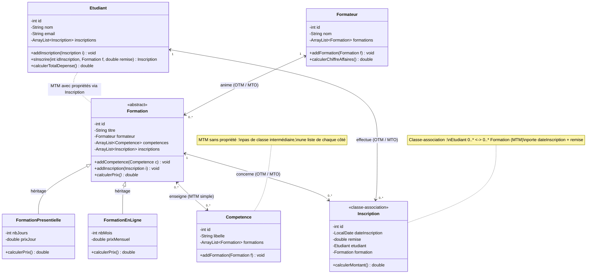

# Plateforme de formations

Un formateur anime des formations. Une formation est présentielle ou en ligne et enseigne des compétences.
Un étudiant s'inscrit à des formations, chaque inscription garde sa date et une remise.

## Diagramme de classes



## Schéma entité-association

```
FORMATEUR (1,1) ──── < anime > ──── (0,n) FORMATION

FORMATION (0,n) ──── < enseigne > ──── (0,n) COMPETENCE

ETUDIANT (0,n) ──── < s'inscrire > ──── (0,n) FORMATION
                     dateInscription
                     remise
```

## Schéma relationnel

```
FORMATEUR(id, nom)
FORMATION(id, titre, type, nbJours, prixJour, nbMois, prixMensuel, #id_formateur)
COMPETENCE(id, libelle)
ENSEIGNER(#id_formation, #id_competence)
ETUDIANT(id, nom, email)
INSCRIPTION(id, dateInscription, remise, #id_etudiant, #id_formation)
```

## Relations

| Relation | Type | En Java |
|---|---|---|
| FormationPresentielle / FormationEnLigne vers Formation | Héritage | `extends Formation`, `@Override calculerPrix()` |
| Formateur / Formation | OTM côté Formateur, MTO côté Formation | `ArrayList<Formation>` dans Formateur, `Formateur formateur` dans Formation |
| Formation / Competence | MTM simple | `ArrayList<Competence>` dans Formation, `ArrayList<Formation>` dans Competence |
| Etudiant / Formation | MTM avec propriétés | classe intermédiaire `Inscription` |
| Etudiant / Inscription | OTM côté Etudiant, MTO côté Inscription | `ArrayList<Inscription>` dans Etudiant, `Etudiant etudiant` dans Inscription |
| Formation / Inscription | OTM côté Formation, MTO côté Inscription | `ArrayList<Inscription>` dans Formation, `Formation formation` dans Inscription |

OTM et MTO sont la même relation lue depuis chaque bout, donc un seul trait sur le schéma.

## Calculs

| Méthode | Classe | Règle |
|---|---|---|
| `calculerPrix()` | `Formation` | abstraite, sans corps |
| `calculerPrix()` | `FormationPresentielle` | `nbJours * prixJour` |
| `calculerPrix()` | `FormationEnLigne` | `nbMois * prixMensuel` |
| `calculerMontant()` | `Inscription` | `formation.calculerPrix() * (1 - remise / 100)`, appelle la méthode abstraite (polymorphisme) |
| `calculerTotalDepense()` | `Etudiant` | somme des `calculerMontant()` de ses inscriptions |
| `calculerChiffreAffaires()` | `Formateur` | somme des `calculerMontant()` des inscriptions de toutes ses formations |

## Tests unitaires

| Classe de test | Cas | Attendu |
|---|---|---|
| `FormationPresentielleTest` | 3 jours à 200 | 600 |
| | 0 jour à 200 | 0 |
| `FormationEnLigneTest` | 4 mois à 30 | 120 |
| | 0 mois à 30 | 0 |
| `InscriptionTest` | présentielle 600 avec 10 % | 540 |
| | en ligne 120 sans remise | 120 |
| | remise de 100 % | 0 |
| | le constructeur ajoute l'inscription chez l'étudiant et la formation | liées |
| `EtudiantTest` | aucune inscription | 0 |
| | 540 + 120 | 660 |
| | `sInscrire` crée une inscription liée | liée |
| `FormateurTest` | `addFormation` renseigne le formateur de la formation | lié |
| | aucune formation | 0 |
| | 540 + 600 + 60 | 1200 |
| `CompetenceTest` | `addCompetence` lie les deux côtés | liés |
| | une compétence dans deux formations | 2 |

Lancer les tests : `mvn test`
